<div align="center">

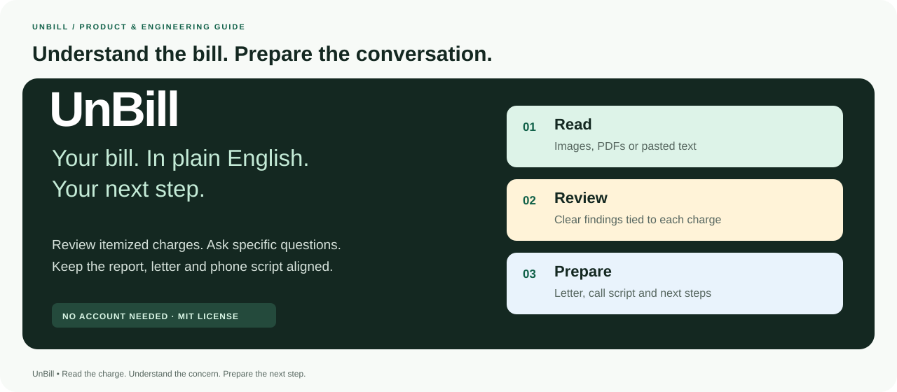

# UnBill

### Understand the charge. Know what to ask. Keep the next step clear.

A medical-bill review workspace that turns itemized statements into explained findings, a selected-charge review letter, a read-aloud phone script, and a conversation worth having.

[**Open the live app**](https://unbill-delta.vercel.app) · [**Explore the ER example**](https://unbill-delta.vercel.app/results/sample_er_wrist_2026) · [**Read the specification**](devpost/spec.md) · [**MIT License**](LICENSE)

<a href="package.json"></a>
<a href="package.json"></a>
<a href="package.json"></a>
<a href="tsconfig.json"></a>
<a href="tailwind.config.ts"></a>
<a href="src/lib/gemini.ts"></a>
<a href="src/app/api/chat/route.ts"></a>
<a href="LICENSE"></a>

**No account required · Synthetic examples included · Selection-driven preparation · Encrypted browser history**

Built for [Build With AI: Basics](https://learn-ai-basics.devpost.com/) using the [Learn AI Basics Skill Pack](https://github.com/challengepost/learn-ai-basics).

</div>

---

## Contents

| Discover the product                                 | Understand the implementation                                 | Run and maintain it                                           |
| ---------------------------------------------------- | ------------------------------------------------------------- | ------------------------------------------------------------- |
| [Why UnBill](#why-unbill)                            | [Architecture](#architecture)                                 | [Quick start](#quick-start)                                   |
| [The complete workflow](#the-complete-workflow)      | [Extraction and model routing](#extraction-and-model-routing) | [Environment configuration](#environment-configuration)       |
| [Features and pages](#features-and-pages)            | [Data model and API](#data-model-and-api)                     | [Verification](#verification)                                 |
| [Reading the results](#reading-the-results)          | [Privacy and storage](#privacy-and-storage)                   | [Deployment](#deployment)                                     |
| [Review methodology](#review-methodology)            | [Sharing and revocation](#sharing-and-revocation)             | [Troubleshooting](#troubleshooting)                           |
| [Letter, script and coach](#letter-script-and-coach) | [Technology stack](#technology-stack)                         | [Repository and documentation](#repository-and-documentation) |

## Why UnBill

A medical statement can show exactly what was charged while still leaving the important questions unanswered: What does a code mean? Was a service listed twice? Is a test already included in a panel? Which number is the patient balance? What should the billing office explain?

UnBill connects those questions to the actual line items. It preserves the statement's available facts, explains the concerns found by its configured checks, and helps prepare a specific follow-up. The person reviewing the bill chooses which charges belong in the request.

The intended audience includes patients reviewing their own statements and people helping a family member prepare for a billing conversation. The public release is designed for **synthetic or de-identified statements**.

The core product idea is continuity: **the same selected charges and amount follow the person from the report into the letter, phone script and saved review.** The result is useful after the first scan, when the next conversation starts.

> **What a finding means:** a reason to request an explanation. It does not confirm a billing error, establish fraud, determine a legal balance or guarantee a reduction. Price comparisons use an illustrative catalog, described in [Review methodology](#review-methodology).

## The complete workflow

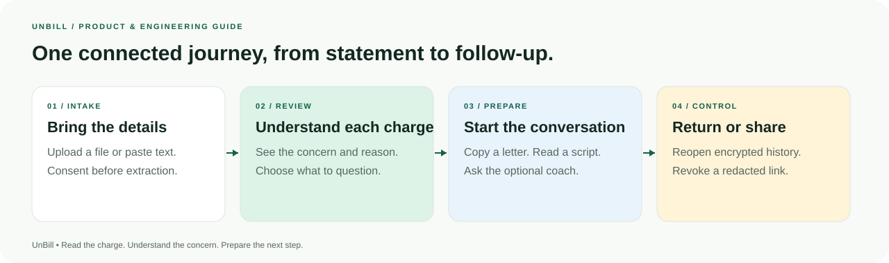

1. **Bring a statement.** Upload a supported image or PDF, paste itemized text, or open a built-in synthetic example.
2. **Authorize document processing.** Uploaded files and pasted text are sent to Gemini after consent. Built-in examples skip this extraction step.
3. **Read the overview.** See how many individual charges need a closer look, the concern categories, original charges, the reported balance and the selected amount to question.
4. **Inspect a charge.** Read its code, date, quantity, amount, concern and suggested question. Expand the supporting explanation when needed.
5. **Choose the follow-up.** Include or exclude flagged charges. The selected amount and preparation package update together.
6. **Prepare the conversation.** Copy or print the review letter, save it as PDF through the browser, and follow a charge-specific phone script.
7. **Ask a follow-up question.** The optional Billing Coach can explain a concern or help phrase a question using minimized report context.
8. **Keep control afterward.** Reopen the review from the local vault, create a separate redacted share link, or revoke shared access.

### Try the reference example

Open the [synthetic ER walkthrough](https://unbill-delta.vercel.app/results/sample_er_wrist_2026), or start at the [scan page](https://unbill-delta.vercel.app/scan). The ER example exercises the review rules, selections, letter and phone guide without an extraction key. Coach and cloud-sharing features depend on their configured services.

To exercise document reading as well, download the [ER PDF](public/samples/er_visit_broken_wrist.pdf), [PNG](public/samples/er_visit_broken_wrist.png) or [statement text](public/samples/er_visit_broken_wrist.txt), then submit it through regular intake. Those are synthetic fixtures, not patient records.

The repository also contains an older outpatient-surgery fixture. Its reported **−$440 patient balance** conflicts with the current nonnegative balance schema; use the ER fixture for the validated reference walkthrough. See [Known limitations](#known-limitations).

## Features and pages

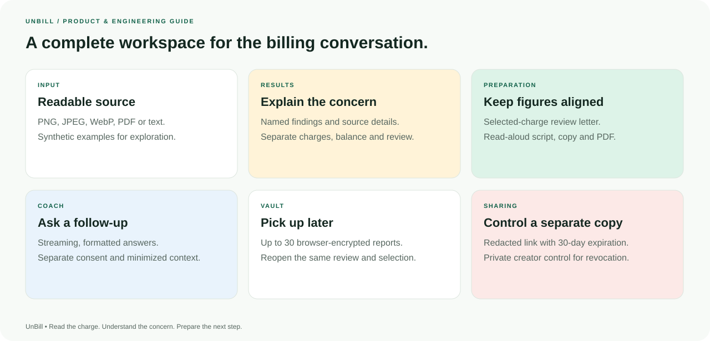

| Surface                | What it provides                                                                     | Why it matters                                                         |
| ---------------------- | ------------------------------------------------------------------------------------ | ---------------------------------------------------------------------- |
| **Home**               | Product explanation, example preview, workflow and entry points                      | Establishes the problem and offers a way to explore without an account |
| **Scan / input**       | File upload, drag-and-drop, pasted text, synthetic examples and consent              | Gives the review a readable, itemized source                           |
| **Processing**         | Preparation, extraction/validation/review and report-opening states; cancellation    | Explains the work being performed without invented percentages         |
| **Results overview**   | Unique affected-charge count, named categories and three separate financial figures  | Makes the result and its numbers understandable at a glance            |
| **Itemized findings**  | Source facts, colored concern labels, explanations, filters and selections           | Connects every question to a specific charge                           |
| **Review letter**      | Selected-charge request, supporting questions, copy, print and browser PDF export    | Produces a practical document to check before sending                  |
| **Phone guide**        | Word-for-word opening, balance questions, per-charge scripts, escalation and closing | Helps turn a concern into a clear conversation                         |
| **Consumer resources** | Contextual explanations and government source links                                  | Provides routes to further information without assuming eligibility    |
| **Billing Coach**      | Consented, contextual streaming answers with formatted Markdown                      | Helps explain unfamiliar wording and prepare follow-up questions       |
| **Vault**              | Up to 30 encrypted browser-local reports and saved selections                        | Keeps the same review available before a later call                    |
| **Redacted sharing**   | A separate shareable copy, expiration and creator-controlled revocation              | Enables optional sharing while removing direct identifiers             |
| **Privacy and About**  | Data boundaries, storage limitations, review method and source links                 | Makes the product's operation inspectable                              |

### Application routes

| Route           | Purpose                                                         |
| --------------- | --------------------------------------------------------------- |
| `/`             | Landing page and synthetic-example entry points                 |
| `/scan`         | Upload, text intake, consent and processing                     |
| `/results/[id]` | Exact saved/sample/shared report, selections, sharing and coach |
| `/dispute/[id]` | Matching review letter, phone guide and consumer resources      |
| `/history`      | Local vault, deletion and share-link revocation                 |
| `/privacy`      | Processing, device history, sharing and provider boundaries     |
| `/about`        | Method, feature explanations, repository and license links      |

An unknown report ID produces an unavailable-report state. The application does not silently substitute an unrelated example for a missing report.

## Reading the results

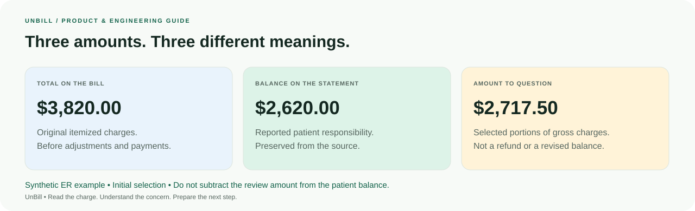

### The three financial figures

| Figure                             | Meaning                                             | Interpretation                                                                                       |
| ---------------------------------- | --------------------------------------------------- | ---------------------------------------------------------------------------------------------------- |
| **Total on the bill**              | Sum of the original itemized line charges           | Describes gross charges before payments and adjustments                                              |
| **Balance shown on the statement** | Patient balance printed on the source, if available | Preserved as a reported value; unknown stays unknown and zero remains zero                           |
| **Amount to question**             | Selected, non-overlapping portions of gross charges | Organizes the request for review; it is not a refund, a legal allowance or a revised patient balance |

The reference ER example starts with **8 charges**, **$3,820.00** gross, **$2,620.00** reported patient responsibility and **$2,717.50** selected for review. These are synthetic example figures, not measured customer savings.

Do not subtract the amount to question from the reported patient balance. A confirmed correction must be interpreted by the provider and insurer against the actual adjustments and coverage.

### What the itemized view shows

Each charge displays the available code, service date, quantity, description, billed amount and selected amount to question. Concerns are visible without opening every detail panel. Expanded details explain the service, the comparison and the question to ask.

Filters show **all charges**, **charges to check**, **price comparisons**, or **charges without a price reference**. A missing reference is shown as unassessed, rather than a verified fair price.

The overview counts individual affected charges, not the total number of rule findings. One charge can carry several different concerns.

## Review methodology

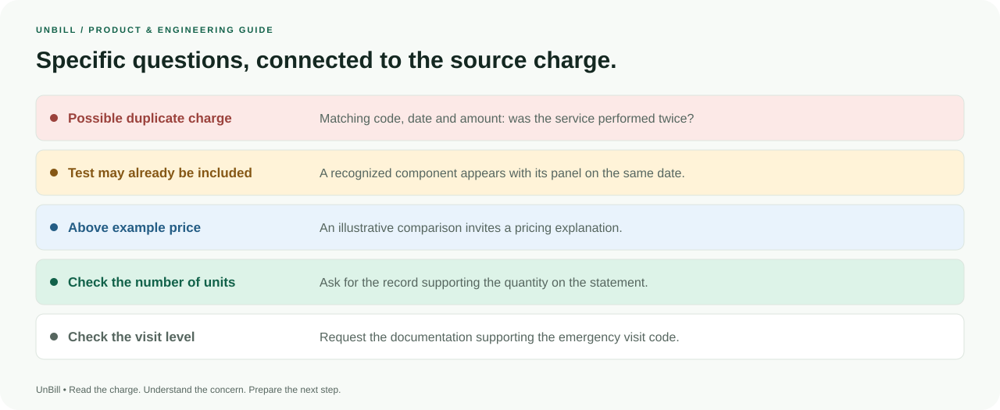

The domain rules operate on validated structured items. They are deterministic: given the same line items and catalog, they produce the same findings. Gemini reads the source; it does not decide the final review arithmetic.

| Check                             | Actual trigger or evidence                                                                                        | Result and boundary                                                                                                     |
| --------------------------------- | ----------------------------------------------------------------------------------------------------------------- | ----------------------------------------------------------------------------------------------------------------------- |
| **Possible duplicate**            | Matching normalized code, service date, provider identifier when present, and line amount                         | Additional matching rows are candidates for explanation; repeat services and modifiers can justify them                 |
| **Panel/component overlap**       | Recognized panel and component on the same known service date, respecting available provider/modifier information | Asks whether the component was separate or already included; it does not establish medical necessity                    |
| **Illustrative price comparison** | A supported charge reaches its configured threshold or 2.5× the quantity-adjusted example reference               | Uses the difference above 1.5× the example reference as a review portion; neither multiplier is a legal or insurer rule |
| **Quantity documentation**        | Quantity exceeds a supported catalog entry's configured encounter value                                           | Requests documentation; quantity alone contributes no estimated reduction                                               |
| **Emergency visit level**         | Emergency department code `99285`                                                                                 | Requests supporting documentation; the bill alone cannot establish upcoding or clinical acuity                          |

Repeat/distinct-service modifiers recognized by the rules include `59`, `76`, `77`, `91`, `XE`, `XP`, `XS` and `XU`. Unknown codes or missing service dates are not guessed into existence. Checks that need those facts can remain incomplete.

### Catalog provenance

The [reference catalog](data/cpt_benchmarks.json) contains **19 manually curated demonstration entries**. [Metadata](data/benchmark_metadata.json) records its purpose and limitations. CMS and AMA links explain coding concepts; those organizations do not supply or endorse the illustrative dollar values.

The catalog is not an official reimbursement schedule, hospital price list, payer allowance, market-percentile dataset or hospital-specific amounts-generally-billed calculation. Broader production pricing would require appropriately licensed, dated and geographically relevant data.

### One selected amount per charge

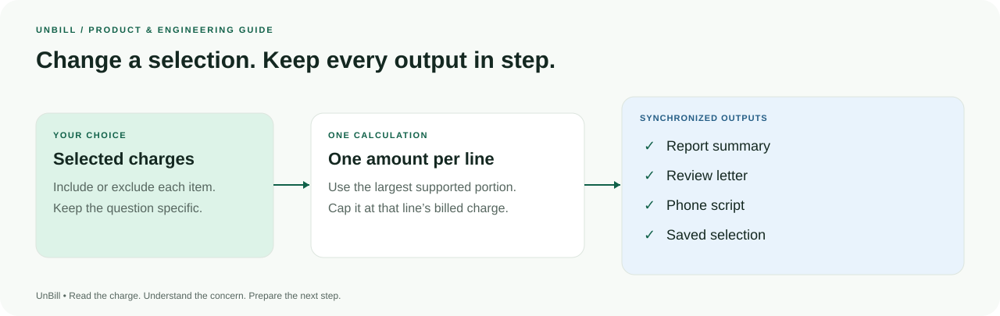

For each selected line, UnBill uses the largest nonnegative review portion supported by its findings, capped at that line's billed charge. It sums that amount once per selected line and caps the total at gross charges.

```text
line review portion = min(line billed amount, largest nonnegative finding amount)
selected total      = min(gross charges, sum of selected line review portions)
```

This prevents a duplicate flag and a price flag on the same charge from being added together as two separate reductions. Selection changes regenerate the letter and phone script and persist the updated report.

Implementation: [rules-engine.ts](src/lib/rules-engine.ts), [review-language.ts](src/lib/review-language.ts), [validation.ts](src/lib/validation.ts).

## Letter, script and coach

### Review letter and PDF

The deterministic letter includes available facility/account details, the statement date, selected services, billed amounts, the amount requested for review and the reasons for asking. It requests supporting documentation or a corrected itemized statement where appropriate.

The same selected total appears in the package and closing request. The letter does not depend on a generative model inventing its figures or legal language.

Use **Copy Letter** to edit the text elsewhere, or **Print / Save as PDF** to open the browser's print interface. Confirm the recipient, facts and contact details before use. The app prepares the document; it does not send it or contact the billing office.

### Read-aloud phone script

The phone guide follows the current selection and includes:

1. An opening that identifies the account and asks for the right department.
2. A clear explanation of the selected review request.
3. Questions about the stated balance, payments and insurance adjustments.
4. One spoken section per selected charge, with questions specific to its findings.
5. Financial-assistance, self-pay and payment-plan questions.
6. Escalation and review-timeline wording when the concern remains unresolved.
7. A read-back closing that requests written confirmation of next steps.

The page also lists preparation materials, uses an extracted billing number only when present, and prompts the person to verify that number against the source. **Copy Phone Script** and printing support use outside the application. Call notes are kept outside the app.

### Optional Billing Coach

The coach receives question history and minimized report context: gross charges, reported balance, selected amount, selected codes/charges/reasons and limitations. Generated context omits direct patient/account identifiers. Anything typed into a question is still transmitted, so identifying details should be left out.

Answers stream into a viewport-bounded dialog. The conversation scrolls independently of the composer; headings, lists, emphasis and quoted scripts render as formatted content. Raw HTML is skipped, unsafe links are not enabled, and response images are not rendered. Suggested prompts, cancellation and clearing the conversation are available.

The coach is an educational conversational assistant. It cannot alter the bill, phone the provider, establish fraud, promise savings or negotiate a settlement.

### Consumer resources

The package links to sources about itemized review requests, qualifying credit-account billing errors, nonprofit-hospital assistance and potential surprise-billing protections. Eligibility depends on the actual account, facility, coverage and circumstances. See [resource definitions](data/legal_statutes.json).

## Architecture

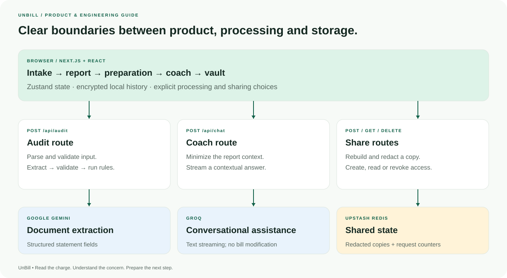

UnBill is a single Next.js App Router application. React pages provide the product workflow; Node.js route handlers hold provider credentials, validate requests and coordinate the external services.

| Boundary                  | Responsibility                                                       | Main source                                                                                                                                                                     |
| ------------------------- | -------------------------------------------------------------------- | ------------------------------------------------------------------------------------------------------------------------------------------------------------------------------- |
| **Intake and results**    | Read input, show processing, explain findings, select charges        | [scan](src/app/scan/page.tsx), [results](src/app/results/[id]/page.tsx), [review summary](src/components/review-summary.tsx), [itemized review](src/components/audit-table.tsx) |
| **Document extraction**   | Call Gemini with a JSON schema and validate the result               | [gemini.ts](src/lib/gemini.ts), [audit route](src/app/api/audit/route.ts)                                                                                                       |
| **Domain model**          | Compute findings, bound review amounts and generate preparation text | [rules-engine.ts](src/lib/rules-engine.ts), [types](src/types/audit.ts)                                                                                                         |
| **State and persistence** | Retain exact reports, selections and private share controls          | [store.ts](src/lib/store.ts), [vault-storage.ts](src/lib/vault-storage.ts)                                                                                                      |
| **Report loading**        | Resolve exact local, sample or shared IDs and validate stored data   | [use-report.ts](src/hooks/use-report.ts), [reports.ts](src/lib/reports.ts)                                                                                                      |
| **Coach**                 | Minimize context, stream provider text and safely render formatting  | [chat route](src/app/api/chat/route.ts), [coach](src/components/billing-coach.tsx), [renderer](src/components/coach-message.tsx)                                                |
| **Sharing**               | Rebuild, redact, store, retrieve and revoke a separate report        | [share route](src/app/api/share/route.ts)                                                                                                                                       |
| **Request protection**    | Body limits, origin checks, network counters and shared budgets      | [api-utils.ts](src/lib/api-utils.ts), [gemini-budget.ts](src/lib/gemini-budget.ts)                                                                                              |

The sample and direct structured-input paths bypass document extraction and run the same domain engine. Report normalization treats stored/shared JSON as untrusted; valid derived content is rebuilt or recalculated rather than blindly trusted.

## Extraction and model routing

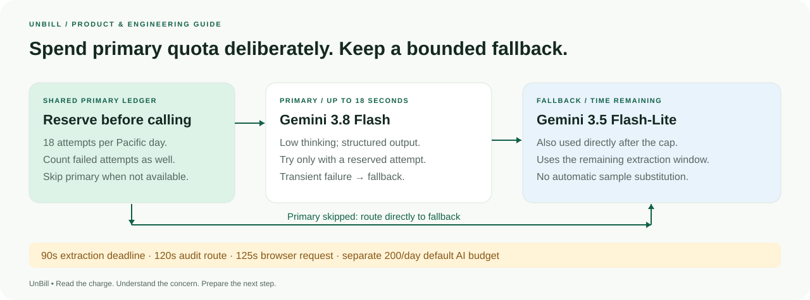

### Provider roles

| Purpose                            | Default primary                    | Default fallback                  |
| ---------------------------------- | ---------------------------------- | --------------------------------- |
| **Structured document extraction** | `gemini-3.8-flash`                 | `gemini-3.5-flash-lite`           |
| **Streaming billing conversation** | `openai/gpt-oss-120b` through Groq | `openai/gpt-oss-20b` through Groq |

These are application defaults, not a promise of provider availability, pricing or account access. Environment overrides are available. Gemini 3.8 requests use low thinking without a custom temperature; extraction requests specify a JSON response schema.

### Two different quota controls

| Control                            | Scope                                        | Reset and behavior                                                                                                                           |
| ---------------------------------- | -------------------------------------------- | -------------------------------------------------------------------------------------------------------------------------------------------- |
| **Primary attempt cap: 18**        | First configured extraction model            | Redis reserves attempts atomically across workers by `America/Los_Angeles` calendar day. After the cap, extraction goes directly to fallback |
| **Default AI request budget: 200** | Guarded document and coach requests combined | Configurable with `AI_DAILY_REQUEST_LIMIT`; the day key follows UTC                                                                          |

Failed primary attempts count conservatively. A confirmed daily/zero-quota primary response stops further primary attempts for that quota day. `GEMINI_QUOTA_SCOPE` keeps the ledger stable across deployments and key rotations. Other applications using the same Google project can consume additional quota outside this ledger.

In public deployment, a primary attempt is not made without a usable shared ledger. Guarded public AI requests also require working Redis request protection. These are application policies, not universal free-tier limits.

### Waiting, fallback and errors

- The primary extraction attempt has an **18-second** ceiling.
- Both extraction attempts share a **90-second** overall deadline. A fast primary failure leaves more time for fallback; skipping the primary leaves the full remaining window.
- The audit route allows **120 seconds** and the intake browser request **125 seconds**, leaving room for request overhead.
- Extraction uses at most one attempt per distinct configured model. Transient rate/server/model/network/timeout failures can reach fallback. Authentication, document or validation failures are reported rather than hidden behind a synthetic result.
- The coach has a separate **25-second** route-level request signal and **30-second** client wait, with a **40-second** hosting ceiling. Fallback applies to supported initial provider failures; an interrupted stream is reported to the conversation.

Errors distinguish authentication/configuration, unavailable models, rate limits, daily quota, busy responses, timeout, network failure and invalid extraction. Provider response bodies, documents and credentials are not printed by extraction diagnostics; logs use the model, safe category, status when available and elapsed time.

## Privacy and storage

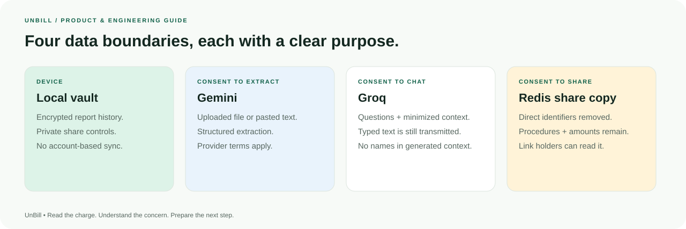

| Data or operation                          | Destination                                      | Important boundary                                                                                                           |
| ------------------------------------------ | ------------------------------------------------ | ---------------------------------------------------------------------------------------------------------------------------- |
| **Uploaded image/PDF or pasted text**      | Application server → Gemini after consent        | The application does not intentionally persist the original upload; infrastructure/provider records depend on their policies |
| **Built-in example**                       | Domain rules in the application                  | No document-extraction provider call                                                                                         |
| **Saved reports and share-owner controls** | Encrypted storage in the current browser         | No account-based sync or server recovery                                                                                     |
| **Coach questions and minimized summary**  | Application server → Groq after separate consent | Typed text is transmitted; chat is not intentionally persisted by the app                                                    |
| **Explicitly shared report**               | Redacted copy in Upstash Redis                   | Remaining procedure details and amounts are visible to link holders                                                          |
| **Request counters**                       | Redis in public deployments                      | Network identifiers are hashed for rate-limit keys; global and model budgets are separate counters                           |

### Browser vault

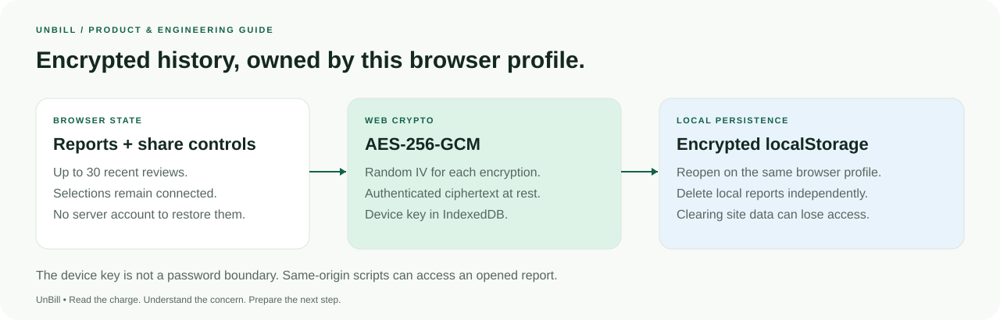

Reports and private share controls are encrypted with **AES-256-GCM** using Web Crypto. Each encryption uses a fresh random IV. The nonextractable `CryptoKey` is stored in IndexedDB; ciphertext is stored in localStorage. Up to 30 recent reports are retained, with up to 100 share-owner controls in the persisted state.

This protects the saved representation, not an unlocked session from scripts with access to the same origin. It is not a password boundary. Switching browser profiles, clearing site data or losing the device key can make saved reports unavailable. The vault has no account-based recovery.

Older local records are validated during migration. When available, an encrypted legacy recovery archive can be downloaded; a recovered file can contain private information.

### Application controls

The app includes runtime schemas, file signatures and size limits, server-side provider keys, same-origin checks on guarded requests, distributed request counters, cancellation, noncached API responses and deployment security headers. Headers include CSP, frame restrictions, MIME-sniffing protection, referrer policy, permissions policy and HSTS.

These controls are not a certification. The public demonstration is not a regulated health-record service, and no HIPAA certification or blanket zero-retention claim is made. Sensitive-data use requires appropriate provider arrangements, operational practices and organizational review.

Read the [in-app privacy notice](https://unbill-delta.vercel.app/privacy) and [operating guide](docs/07_MANUAL_STEPS_AND_CONFIG.md) for the full boundaries.

## Sharing and revocation

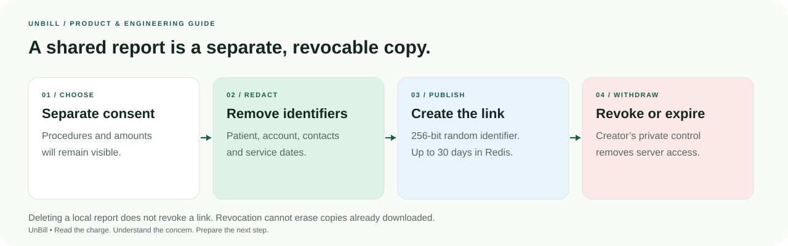

1. The creator explicitly authorizes sharing the remaining procedure details and amounts.
2. The server validates the report, rebuilds findings and applies the chosen selection before publication.
3. Redaction removes direct patient/account identifiers, facility contact details, service dates and provider IDs. Raw descriptions are replaced with the available plain-language descriptions.
4. A **256-bit random identifier** addresses the shared report. A separate random revocation token is returned to the creator.
5. Redis retains the redacted copy for **30 days**. The server stores a SHA-256 hash of the revocation token, not the plaintext token.
6. The private token is retained in the creator's encrypted vault. An authorized revoke request deletes the server record; subsequent retrieval returns an unavailable-report response.

Anyone holding an active link can read the remaining report. Redaction does not make medical procedure information nonsensitive. **Deleting a local report does not revoke its link**, and revocation cannot erase a copy already downloaded. Keep the creating browser available while the link is active.

## Technology stack

| Layer              | Technology                                                      | Role                                                                       |
| ------------------ | --------------------------------------------------------------- | -------------------------------------------------------------------------- |
| Application        | **Next.js 15**, App Router, Node.js **22.x**                    | Pages, route handlers, production bundle and hosting configuration         |
| Interface          | **React 19**, strict **TypeScript**, **Tailwind CSS 3**, Lucide | Responsive pages, typed components and accessible controls                 |
| State              | **Zustand**                                                     | Current report, selected charges, history and share-owner controls         |
| Validation         | **Zod**                                                         | Untrusted request, extraction, report and chat boundaries                  |
| Extraction         | **Gemini REST structured output**                               | Read supported source documents into itemized fields                       |
| Conversation       | **Groq SDK**, `react-markdown`                                  | Streaming contextual answers and structured rendering                      |
| Shared services    | **Upstash Redis**                                               | Distributed protection, primary attempt ledger and redacted report storage |
| Device persistence | **Web Crypto**, **IndexedDB**, `idb-keyval`, localStorage       | Device key and authenticated encrypted state                               |
| Verification       | **Node test runner**, `tsx`, fake IndexedDB, ESLint, TypeScript | Deterministic regression checks and build gates                            |
| Hosting            | **Vercel-compatible Next.js deployment**                        | Node route execution and Git-connected deployment                          |

Exact installed versions are recorded in [package-lock.json](package-lock.json); supported runtime and scripts are in [package.json](package.json).

## Quick start

### Requirements

Use **Node.js 22.x**, npm and a modern browser with Web Crypto and IndexedDB. API keys are optional when exploring the synthetic review flow. Public AI endpoints and cloud sharing require Redis.

```bash
git clone https://github.com/z-lovejeet/UnBill.git
cd UnBill
npm ci
cp .env.example .env.local
npm run dev
```

Open [localhost:3000](http://localhost:3000), then choose the **Synthetic ER Example** on the scan page. The default local example path does not need provider credentials or Redis. Use `npm ci` to install the checked-in dependency graph.

### Choose the capabilities needed

| Local setup                               | Required configuration                                       | Available workflow                                            |
| ----------------------------------------- | ------------------------------------------------------------ | ------------------------------------------------------------- |
| **Explore the ER example**                | No external service credentials                              | Report, selections, letter, phone guide and browser vault     |
| **Read uploaded documents / pasted text** | `GEMINI_API_KEY`                                             | Extraction followed by the same validated review engine       |
| **Use the Billing Coach**                 | `GROQ_API_KEY`                                               | Contextual streaming answers after coach consent              |
| **Create/revoke share links**             | Redis URL and token                                          | Redacted server copies with expiration and private revocation |
| **Host public AI features**               | Relevant provider keys, Redis protection and HTTPS `APP_URL` | Guarded extraction/coach and configured sharing               |

Local development can use in-memory request counters when Redis is absent. They do not coordinate across instances and are not a public-hosting substitute.

## Environment configuration

Start from [.env.example](.env.example). All credentials belong in the server environment. `.env.local` and other local secret files are ignored by Git.

| Variable                   | Default or example              | Purpose                                                                                                    |
| -------------------------- | ------------------------------- | ---------------------------------------------------------------------------------------------------------- |
| `GEMINI_API_KEY`           | Empty                           | Enables uploaded-document and pasted-text extraction                                                       |
| `GEMINI_MODEL`             | `gemini-3.8-flash`              | First extraction model, covered by the primary ledger                                                      |
| `GEMINI_FALLBACK_MODEL`    | `gemini-3.5-flash-lite`         | Second extraction model                                                                                    |
| `GEMINI_QUOTA_SCOPE`       | `unbill`                        | Stable namespace for shared primary-attempt accounting; letters, numbers, `_` and `-`, up to 80 characters |
| `GROQ_API_KEY`             | Empty                           | Enables the optional Billing Coach                                                                         |
| `GROQ_MODEL`               | `openai/gpt-oss-120b`           | Primary coach model served through Groq                                                                    |
| `GROQ_FALLBACK_MODEL`      | `openai/gpt-oss-20b`            | Fallback coach model                                                                                       |
| `UPSTASH_REDIS_REST_URL`   | Empty                           | Redis REST endpoint for protection, sharing and quota accounting                                           |
| `UPSTASH_REDIS_REST_TOKEN` | Empty                           | Redis server credential                                                                                    |
| `APP_URL`                  | `http://localhost:3000` locally | Canonical origin for links and allowed-origin checks; use the deployed HTTPS origin publicly               |
| `AI_DAILY_REQUEST_LIMIT`   | `200`                           | Positive integer cap for guarded AI requests per UTC day                                                   |
| `ALLOW_LOCAL_RATE_LIMIT`   | `false`                         | Permit in-memory guards for isolated local production testing only                                         |
| `TRUST_PROXY`              | `false`                         | Trust sanitized forwarded network information behind a controlled non-Vercel proxy                         |

`NEXT_PUBLIC_APP_URL` is supported as a legacy origin fallback, but prefer `APP_URL`. No provider or Redis secret should use a `NEXT_PUBLIC_` name. Vercel forwarding is detected automatically; `TRUST_PROXY` should only be enabled where the proxy strips or sanitizes client-supplied forwarded headers.

Changing the public origin or server environment requires redeploying with the intended values. Rotating a Gemini key does not reset the application ledger or increase the underlying Google project's quota.

## Data model and API

### Canonical report

| Type               | Important fields                                                                                                                                            |
| ------------------ | ----------------------------------------------------------------------------------------------------------------------------------------------------------- |
| `RawLineItem`      | Unique ID, code or empty string, description, known/empty service date, positive integer quantity, full line charge, optional printed modifiers/provider ID |
| `AuditedLineItem`  | Raw facts plus plain-language description, category, reference values, findings, status and selection                                                       |
| `FinancialSummary` | Gross charges, source adjustment figure, nullable reported patient responsibility, selected review amount and heuristic priority score                      |
| `AuditReport`      | Schema version 2, exact ID, source, timestamp, facility/patient metadata, items, findings, warnings and regenerated package                                 |
| `DisputePackage`   | Formal letter text, conditional source references, selected-charge phone script and generation timestamp                                                    |

The internal field `totalPotentialSavings` is a compatibility name for the **selected gross-charge review amount**. It must not be interpreted as confirmed patient savings. `riskScore` is a heuristic prioritization value, not a probability of fraud or a legal assessment.

See [types](src/types/audit.ts), [runtime schemas](src/lib/validation.ts) and [data-model notes](docs/04_DATA_MODELS_AND_SCHEMAS.md).

### Endpoints

| Method and endpoint   | Input                                                                   | Response or behavior                                                      |
| --------------------- | ----------------------------------------------------------------------- | ------------------------------------------------------------------------- |
| `GET /api/health`     | None                                                                    | Configuration-presence flags; no secret values and no live provider probe |
| `POST /api/audit`     | One sample ID, direct structured bill, consented text or consented file | Canonical report or a safe validation/provider error                      |
| `POST /api/chat`      | `consent: true`, message history and optional report context            | Streamed plain-text Markdown consumed by the coach renderer               |
| `POST /api/share`     | `consent: true` and a complete `auditReport`                            | Share ID, URL, expiration and creator-only revocation token               |
| `GET /api/share?id=…` | Valid share ID                                                          | Redacted report; unavailable after expiry or revocation                   |
| `DELETE /api/share`   | Share ID and private revocation token                                   | Revocation confirmation; incorrect token is rejected                      |

All JSON requests use `Content-Type: application/json`. The audit route accepts `rawBillData` or `billData` for direct structured input. Uploaded content uses `imageBase64` and a supported `mimeType`; a data-URL prefix is accepted. Send one document or text payload at a time.

<details>
<summary><strong>Example: review the synthetic ER sample without a provider call</strong></summary>

```bash
curl http://localhost:3000/api/audit \
  -H 'Content-Type: application/json' \
  -d '{"sampleId":"er_visit_broken_wrist"}'
```

The response has `source: "sample"`. Selecting a sample does not test Gemini availability.

</details>

<details>
<summary><strong>Example: review a synthetic pasted statement</strong></summary>

```bash
curl http://localhost:3000/api/audit \
  -H 'Content-Type: application/json' \
  -d '{
    "consent": true,
    "rawText": "SYNTHETIC DEMO — NOT FOR PAYMENT. Demo Clinic. Account DEMO-001. Statement 2026-10-26. Service date 2026-10-18. Code 80053, metabolic panel, quantity 1, full line charge $200.00. Gross charges $200.00. Patient balance $200.00."
  }'
```

This request uses Gemini and consumes provider quota. Never use identifying real patient data in the public demonstration.

</details>

<details>
<summary><strong>Example: run the domain engine using explicit structured facts</strong></summary>

```json
{
  "rawBillData": {
    "facility": { "name": "Synthetic Demo Clinic" },
    "patient": { "accountNumber": "DEMO-001", "statementDate": "2026-10-26" },
    "financials": { "totalBilledGross": 200, "patientBalanceDue": 200 },
    "items": [
      {
        "id": "line-1",
        "code": "80053",
        "rawDescription": "Synthetic metabolic panel",
        "dateOfService": "2026-10-18",
        "quantity": 1,
        "billedAmount": 200
      }
    ]
  }
}
```

This skips extraction and does not demonstrate source-document recognition. `billedAmount` is the full line total, not the unit price.

</details>

### Supported input and request limits

| Boundary                 | Current limit                                                                                  |
| ------------------------ | ---------------------------------------------------------------------------------------------- |
| Raw uploaded file        | 2,500,000 bytes; PNG, JPEG, WebP or PDF with matching file signature                           |
| Pasted statement         | 1–50,000 nonblank characters                                                                   |
| Itemized statement       | 1–200 line items                                                                               |
| Quantity                 | Positive integer, up to 10,000                                                                 |
| Money fields             | Finite, nonnegative, at most two decimal places; supported total up to $100 million            |
| Service dates            | Valid `YYYY-MM-DD`, or empty when unknown                                                      |
| Gross reconciliation     | Difference from summed line charges must be within $0.02                                       |
| Audit JSON body          | 3,600,000 bytes, including Base64/JSON overhead                                                |
| Chat/share creation body | 500,000 bytes                                                                                  |
| Chat history             | 1–20 nonempty messages, up to 4,000 characters per message; last message must be from the user |
| Share revocation body    | 2,000 bytes                                                                                    |

Guarded requests use one-minute network buckets: **6 document audits**, **20 coach requests**, **5 share creations**, **60 share reads**, and **20 revocations** per minute. Same-origin checks apply when an Origin header is present. These controls are not authentication or a comprehensive abuse-prevention service.

## Verification

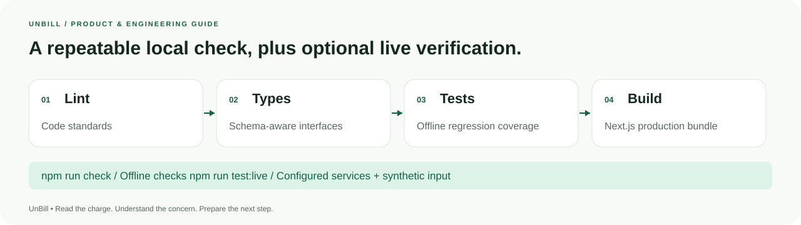

### Local checks

```bash
npm run check
```

This runs ESLint, TypeScript, the offline regression suite and a Next.js production build. The current suite contains **29 tests** across three files:

| Suite                                                  | Coverage                                                                                                                                                             |
| ------------------------------------------------------ | -------------------------------------------------------------------------------------------------------------------------------------------------------------------- |
| [release.test.ts](tests/release.test.ts)               | Financial reconciliation, selection consistency, modifiers/dates, unknown facts, schema rejection, encrypted persistence, redaction, endpoints and origin protection |
| [gemini-routing.test.ts](tests/gemini-routing.test.ts) | Shared primary policy behavior, fallback, Pacific reset, safe errors, missing-ledger behavior and extraction deadlines                                               |
| [presentation.test.ts](tests/presentation.test.ts)     | Markdown formatting and unsafe-content handling, expanded selected-charge scripts and unique affected-charge counts                                                  |

The routing suite uses controlled provider responses and clocks. It proves application behavior, not Google or Groq uptime. Historical audit artifacts under [docs/audits](docs/audits/README.md) describe their recorded revisions rather than automatically certifying the current deployment.

### Optional live smoke suite

Start a configured local production server in one terminal:

```bash
npm run build
ALLOW_LOCAL_RATE_LIMIT=true APP_URL=http://127.0.0.1:3107 \
  npm start -- --hostname 127.0.0.1 --port 3107
```

Run the smoke suite in another terminal:

```bash
UNBILL_SMOKE_URL=http://127.0.0.1:3107 npm run test:live
```

The suite exercises health/headers, sample responses, text/image/PDF extraction, rejection, streaming chat, redacted sharing and authorized/unauthorized revocation. It uses synthetic input, consumes provider requests, creates a temporary share and removes its own share record. Results are written to `docs/audits/2026-10-26/release-live-verification.json`; that fixed output location does not imply the run occurred on that date.

**Timing caveat:** the current smoke client's individual POST timeout is 50 seconds, shorter than the app's 90-second extraction deadline. A slow successful browser review can therefore outlast this diagnostic client. Inspect the actual error and timing before treating a smoke timeout as proof that the browser workflow cannot complete.

For an explicitly chosen HTTPS deployment, set `UNBILL_SMOKE_URL` to that origin. Do not run live provider checks repeatedly just to verify documentation or SVG changes.

### Useful commands

| Command                                     | Purpose                                                                            |
| ------------------------------------------- | ---------------------------------------------------------------------------------- |
| `npm run dev`                               | Start the development application                                                  |
| `npm run lint`                              | Check application/config code standards                                            |
| `npm run typecheck`                         | Validate TypeScript interfaces                                                     |
| `npm test`                                  | Run the offline regression suite                                                   |
| `npm run build`                             | Create the production application                                                  |
| `npm start`                                 | Serve the existing production build                                                |
| `npm run check`                             | Run lint, types, tests and build in sequence                                       |
| `npm run test:live`                         | Opt in to configured-service smoke checks                                          |
| `npm run samples`                           | Regenerate sample JSON/text/SVG representations from the sample data               |
| `python3 scripts/generate-readme-assets.py` | Regenerate the twenty self-contained README SVGs using the Python standard library |
| `npm audit --audit-level=moderate`          | Inspect current dependency-advisory information                                    |

Sample PDF generation is separate: [generate-demo-pdfs.py](scripts/generate-demo-pdfs.py) uses ReportLab, and sample PNGs are rendered from PDFs. Regenerating samples is a deliberate fixture maintenance action, not an application startup requirement.

## Deployment

The repository includes a [Vercel configuration](vercel.json) with `npm ci` installation, `npm run build`, the Next.js framework and `iad1` region preference. Node.js **22.x** is specified in `package.json`. No relational-database migration is required; Redis serves the distributed state used here.

1. Connect the repository to a Node.js Next.js hosting project, or use the existing Vercel connection.
2. Configure the provider keys for the intended features, Redis URL/token, stable quota scope and daily budget in the hosting server environment.
3. Set `APP_URL` to the actual HTTPS production origin. Keep `ALLOW_LOCAL_RATE_LIMIT=false` publicly.
4. Deploy the chosen commit. Rebuild after environment changes so the intended configuration is attached to the deployment.
5. Inspect `/api/health` for configuration presence. A `status: "ok"` response does not establish provider availability, key validity, quota or successful Redis operations.
6. When service verification is needed, run the synthetic smoke suite against the exact origin and interpret its timeout limits. Inspect a redacted link separately and verify revocation when testing that feature.
7. Monitor safe error categories, provider budgets and Redis availability. Retain a known-good deployment for rollback.

Public AI endpoints fail closed when distributed request protection is missing or unavailable. Setting an API key alone does not enable a safe public operating configuration. Built-in examples remain independent of extraction-provider availability, subject to their own fixture validity.

The application can also run on another compatible Node.js Next.js host. Use a controlled proxy before enabling trusted forwarded-header handling, and respect the function-duration and request-body requirements of the chosen platform.

Detailed configuration, incident handling and rollback: [operating guide](docs/07_MANUAL_STEPS_AND_CONFIG.md).

## Troubleshooting

| Symptom                                          | Likely boundary                                                               | Practical next step                                                                                               |
| ------------------------------------------------ | ----------------------------------------------------------------------------- | ----------------------------------------------------------------------------------------------------------------- |
| File is rejected before reading                  | Unsupported MIME/signature, empty file or file above 2.5 MB                   | Use a supported readable export within the raw-file limit, or paste the itemized text                             |
| Statement needs review / totals do not reconcile | Missing pages, credits, extraction error or a subtotal mistaken for gross     | Compare source line totals and include the complete itemized statement                                            |
| Extraction provider rejects configuration        | Key or model access is invalid for the server environment                     | Check server-side configuration and rebuild; never paste keys into logs or issues                                 |
| Model is unavailable                             | The configured model is not available to the provider account                 | Verify model access and permitted overrides                                                                       |
| Busy, rate or daily-quota error                  | Provider capacity or account quota, or an application budget                  | Read the safe error code, inspect the relevant counter and use the ER example while investigating                 |
| Extraction times out                             | Provider response exceeded the bounded request                                | Retry later with a clear source, paste text or use the example; do not infer that a key rotation will fix latency |
| `DAILY_LIMIT`                                    | Combined AI-request budget is exhausted                                       | Check `AI_DAILY_REQUEST_LIMIT` and the UTC-day counter separately from the primary model ledger                   |
| Public AI says protection is unavailable         | Redis is missing or failed                                                    | Restore distributed protection; do not enable the local-only bypass publicly                                      |
| Coach shows a stopped/interrupted response       | Cancellation, provider/network interruption or request deadline               | Retry a focused question or use the deterministic phone guide                                                     |
| Saved report cannot be opened                    | Different browser/profile, cleared data, missing key or invalid stored record | Return to the original browser; there is no server account recovery                                               |
| Shared report is unavailable                     | Expired, revoked or invalid identifier                                        | Ask the creator for a new link if appropriate                                                                     |
| Link survives local report deletion              | Local deletion and server revocation are separate                             | Revoke the link from its owner controls in the vault                                                              |
| Link points at the wrong origin                  | `APP_URL` does not match the deployment                                       | Set the correct HTTPS origin and redeploy                                                                         |
| Old UI labels remain after deployment            | An older application tab is still open                                        | Refresh and reopen the report before checking the new interface                                                   |

### Known limitations

- Coverage is intentionally limited to the configured codes and rules. A row without a finding is not certified correct.
- Negative charges, credit balances, incomplete statements and unreconciled itemization are outside the supported validated intake.
- The checked-in `outpatient_surgery` sample has a negative reported patient balance and cannot pass the current report-normalization schema. The ER sample is the recommended end-to-end fixture until that synthetic dataset is reconciled.
- Price references are illustrative. Provider identity, repeat-service modifiers, coding details and coverage affect interpretation.
- Browser encryption has no password boundary, cross-device sync or account recovery.
- Sharing retains procedures and amounts, and revocation cannot erase downloaded copies.
- Provider availability, latency, policies and quota depend on external services and account configuration.
- The product prepares requests and questions. It does not submit insurance claims, send letters, place calls, take payments or automatically enforce consumer protections.

## Repository and documentation

```text
UnBill/
├── src/
│   ├── app/
│   │   ├── page.tsx                    # Landing page
│   │   ├── scan/                       # Intake and processing
│   │   ├── results/[id]/               # Exact report, selections and sharing
│   │   ├── dispute/[id]/               # Letter, phone guide and resources
│   │   ├── history/                    # Encrypted vault and revocation
│   │   ├── about/                      # Method and project information
│   │   ├── privacy/                    # Data-boundary explanations
│   │   └── api/{audit,chat,share,health}/
│   ├── components/                    # Report, coach and shared page components
│   ├── hooks/use-report.ts             # Local/sample/shared report resolution
│   ├── lib/
│   │   ├── rules-engine.ts             # Findings, bounded amounts and preparation
│   │   ├── review-language.ts          # Plain-language labels and spoken questions
│   │   ├── gemini.ts                   # Structured extraction and fallback
│   │   ├── gemini-budget.ts            # Shared primary quota ledger
│   │   ├── api-utils.ts                # Guards, JSON boundaries and safe responses
│   │   ├── validation.ts               # Runtime request/report schemas
│   │   ├── reports.ts                  # Normalization and redaction
│   │   ├── store.ts                    # Current report, history and selections
│   │   └── vault-storage.ts            # AES-GCM browser persistence
│   └── types/audit.ts                  # Domain interfaces
├── data/                              # Illustrative catalog and resource definitions
├── public/samples/                    # Synthetic statement fixtures
├── tests/                             # Offline regression suites
├── scripts/                           # Smoke checks, fixtures and README SVG generator
├── devpost/                           # Project-specific Skill Pack documents
├── agent/skills/                       # Included Learn AI Basics Skill Pack
├── docs/                              # Engineering guides and historical audit evidence
│   └── assets/readme/                  # Twenty local SVG illustrations and badges
├── .env.example                       # Empty credential template and defaults
├── vercel.json                        # Hosting configuration
├── LICENSE                            # MIT License
└── THIRD_PARTY_NOTICES.md              # Retained notices and data attribution
```

### Skill Pack documents

The project-specific planning documents live under `devpost/`; the included upstream skill instructions live under `agent/skills/`.

| Document                                         | What it explains                                                    |
| ------------------------------------------------ | ------------------------------------------------------------------- |
| [Document index](devpost/README.md)              | Mapping from Skill Pack stages to project material                  |
| [scope.md](devpost/scope.md)                     | Audience, core loop, boundaries and observable success              |
| [prd.md](devpost/prd.md)                         | User journey, screens, requirements and acceptance criteria         |
| [spec.md](devpost/spec.md)                       | Architecture, services, data, source locations and failure handling |
| [checklist.md](devpost/checklist.md)             | Implementation and recorded verification checklist                  |
| [app-map.html](devpost/app-map.html)             | Saved source tour and its source snapshot identifier                |
| [recording.md](devpost/recording.md)             | Demonstration flow and presentation preparation                     |
| [submission.md](devpost/submission.md)           | Factual project overview and submission material                    |
| [shipping-status.md](devpost/shipping-status.md) | Recorded publication status and external submission deliverables    |

The personal learner-profile file is local and Git-ignored. Public documentation is not a personal eligibility attestation or proof of Devpost submission. Older documents and audit records can name earlier deployment revisions; the current implementation and executable schemas determine behavior.

### Engineering references

- [Product requirements](docs/01_PRD.md)
- [System architecture](docs/02_SYSTEM_ARCHITECTURE.md)
- [Extraction and review pipeline](docs/03_MULTI_AGENT_AI_PIPELINE.md)
- [Data models and schemas](docs/04_DATA_MODELS_AND_SCHEMAS.md)
- [UI and component guide](docs/05_UI_UX_AND_COMPONENTS.md)
- [Development roadmap](docs/06_DEVELOPMENT_ROADMAP.md)
- [Setup, deployment and operations](docs/07_MANUAL_STEPS_AND_CONFIG.md)
- [Release plan](docs/08_RELEASE_PLAN.md)
- [Audit evidence index](docs/audits/README.md)

## Contributing

Use Node.js 22.x and the lockfile, reproduce the relevant behavior, and keep changes focused. Run the checks appropriate to the change before opening a contribution.

For domain changes, keep the report, letter and phone script consistent and include a regression covering the real failure pattern. For fixtures, keep JSON/text/SVG and separately generated PDF/PNG versions aligned. For visual documentation, edit the SVG generator and regenerate the local assets.

Use synthetic examples in issues, screenshots and verification. Do not publish patient details, environment files, provider responses containing private text, API keys, Redis tokens or private share-revocation controls.

## License and acknowledgements

UnBill project code is distributed under the **[MIT License](LICENSE)**, copyright © 2026 UnBill contributors. Preserve the license notice when reusing the software.

The included [Learn AI Basics Skill Pack](https://github.com/challengepost/learn-ai-basics) retains its contributors' MIT notices. Dependency licenses remain with their distributions. See [THIRD_PARTY_NOTICES.md](THIRD_PARTY_NOTICES.md) for attribution and the distinction between coding references and illustrative prices.

**Public license link:** [github.com/z-lovejeet/UnBill/blob/main/LICENSE](https://github.com/z-lovejeet/UnBill/blob/main/LICENSE).

---

<div align="center">

**UnBill — a clearer statement, a specific question, a prepared next step.**

[Open the app](https://unbill-delta.vercel.app) · [Explore the ER example](https://unbill-delta.vercel.app/results/sample_er_wrist_2026) · [Read the method](https://unbill-delta.vercel.app/about) · [Data and privacy](https://unbill-delta.vercel.app/privacy)

</div>
