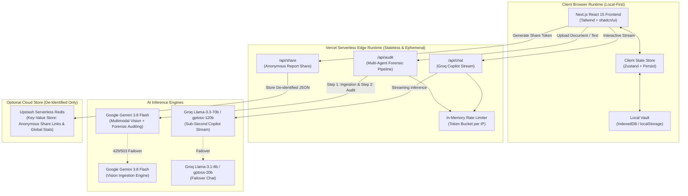

# UnBill — Technical & System Architecture Specification

**Document Version:** 1.0.0  
**Status:** Approved for Implementation  
**Last Updated:** October 2026  
**Target Environment:** Vercel Serverless Edge + Local-First Browser Runtime  
**Author:** UnBill Engineering Core  

---

## 1. High-Level Architectural Topology

UnBill follows a **Hybrid Privacy-First Serverless Architecture**. Intensive multi-modal reasoning and real-time chat are executed on secure, stateless serverless edge functions, while all patient documents, audit reports, and dispute letters are persisted strictly within the client browser runtime (IndexedDB / `localStorage`).



---

## 2. End-to-End Data Flow Sequence

```mermaid
sequenceDiagram
    autonumber
    actor Patient as User / Judge
    participant App as Next.js Client
    participant API as /api/audit (Next.js Serverless)
    participant Gemini as Gemini 3.8 Flash
    participant Rules as In-Memory Rule Engine
    participant LocalStore as Browser IndexedDB

    Patient->>App: Drops Medical Bill Image / Clicks Sample
    App->>App: Pre-validates file (type, size < 15MB)
    App->>API: POST /api/audit (Multipart or Base64 buffer)
    
    Note over API: Agent 1: Clinical Ingestion
    API->>Gemini: Multimodal Vision Prompt + Image Buffer
    Gemini-->>API: Raw Clinical Line Items (JSON)
    
    Note over API: Agent 2: Forensic CPT & Pricing Auditor
    API->>Rules: Cross-reference cpt_benchmarks.json
    Rules->>Rules: Execute Duplicate, Unbundling & Markup Checks
    API->>Gemini: Evaluate Clinical Upcoding Reasoning
    Gemini-->>API: Upcoding Flags & Plain-English Translations
    
    Note over API: Agent 3: Legal & Dispute Advocate
    API->>Rules: Match Flagged Items with legal_statutes.json (FCBA, NSA)
    Rules-->>API: Compiled Legal Citations & Dispute Package
    
    API-->>App: Complete AuditReport JSON (Latency < 4.5s)
    Note over API: Memory buffers flushed; Zero cloud storage
    
    App->>LocalStore: Save to Local History Vault (IndexedDB)
    App->>Patient: Render Interactive Audit Dashboard & Risk Score
```

---

## 3. Dual-LLM Topology & Tiered Fallback Engine

To maximize accuracy, eliminate cold starts, and safeguard against hackathon rate limits (HTTP 429), the system uses a **Dual-LLM, Multi-Tiered Architecture**:

### 3.1 Tier 1: Multimodal Ingestion & Forensic Auditing
* **Primary Model:** `gemini-3.8-flash` (via `@google/genai` SDK)
  * **Role:** High-fidelity vision OCR, unstructured table parsing, complex medical code extraction, and clinical severity reasoning.
  * **Temperature:** `0.1` (Strict deterministic extraction).
  * **Parameters:** `responseMimeType: "application/json"`.
* **Fallback Model:** `gemini-3.5-flash-lite`
  * **Trigger:** Primary fails with HTTP 429 (rate limit), 503 (service unavailable), or response timeout ($>8000$ms).
  * **Implementation:** Wrapped in an automated retry/fallback interceptor.

### 3.2 Tier 2: Real-Time Dispute Copilot Chat
* **Primary Model:** `llama-3.3-70b-versatile` / `gptoss-120b` (via `groq-sdk`)
  * **Role:** Powers the interactive slide-over copilot. Generates rapid negotiation talking points, roleplays hospital phone calls, and explains insurance terminology.
  * **Latency Target:** First token in $<350$ms.
  * **Stream Mode:** Server-Sent Events (SSE) via Next.js `ReadableStream`.
* **Fallback Model:** `llama-3.1-8b-instant` / `gptoss-20b` (on Groq) or Gemini 3.8 Flash as secondary cloud failover.

---

## 4. Privacy, Security & Zero-Retention Architecture

Because medical billing documents contain Protected Health Information (PHI) under HIPAA principles, UnBill implements a **Strict Zero-Retention Model**:

1. **Stateless Edge Execution:**
   * Images uploaded to `/api/audit` are parsed purely in serverless volatile memory (RAM buffers).
   * Buffers are immediately discarded once JSON extraction completes.
   * No files are ever written to disk or uploaded to S3/Cloud Storage.
2. **Client-Side Data Ownership:**
   * All extracted bills, line-item edits, patient account numbers, and generated dispute letters reside entirely in the user's browser storage (IndexedDB / `localStorage`).
   * The user possesses complete data sovereignty with an instant *"Purge All Vault Data"* action.
3. **De-Identified Anonymous Sharing:**
   * If a user generates a shareable link (`/share/[id]`), the client strips all patient names, phone numbers, and addresses. Only de-identified clinical codes, benchmark numbers, and generic hospital names are stored in Upstash Redis.

---

## 5. Persistence & State Management Specification

### 5.1 Client-Side State: Zustand with Hydration Safety
* **Library:** `zustand` with `persist` middleware.
* **Storage Engine:** Standard `localStorage` for lightweight state (active bill, UI toggles, copilot messages) and `idb-keyval` (IndexedDB) for multi-bill historical archives.
* **SSR Safety Guard:** To prevent Next.js hydration errors on Vercel:
  ```typescript
  // store/useAuditStore.ts
  export const useAuditStore = create<AuditState>()(
    persist(
      (set, get) => ({
        currentAudit: null,
        history: [],
        setAudit: (audit) => set({ currentAudit: audit }),
        // ...actions
      }),
      {
        name: 'unbill_vault_v1',
        skipHydration: true, // Prevents SSR window mismatch
      }
    )
  );
  ```

### 5.2 Cloud Persistence (Upstash Serverless Redis)
Used strictly for two non-sensitive, shared operations:
1. **Global Impact Metrics:**
   * Key: `stats:global_dollars_audited` $\rightarrow$ `INCRBY <amount>`
   * Key: `stats:total_bills_scanned` $\rightarrow$ `INCR`
2. **De-Identified Share Links:**
   * Key: `share:{uuid}`
   * Value: Encrypted JSON string of de-identified audit report.
   * TTL: `604800` (7 days auto-expiration).

---

## 6. Rate Limiting & Edge Resilience

To prevent abuse and manage API quotas during judging, the serverless endpoints utilize a token-bucket rate limiter:

* **Algorithm:** In-memory sliding window limiter per client IP address.
* **Quotas:**
  * `/api/audit`: Max 10 scans per IP per hour.
  * `/api/chat`: Max 30 messages per IP per 10 minutes.
* **Header Response:** Standard `X-RateLimit-Limit`, `X-RateLimit-Remaining`, `X-RateLimit-Reset`.
* **Graceful Degradation:** If rate limits are approached, the app informs the user with an intuitive countdown and offers instant 1-click synthetic sample bills that bypass API calls entirely.
